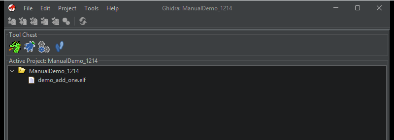
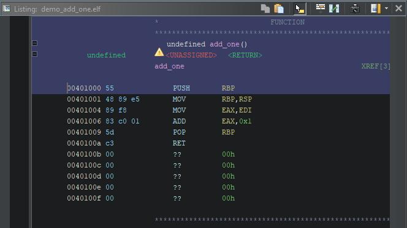
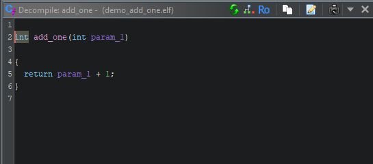
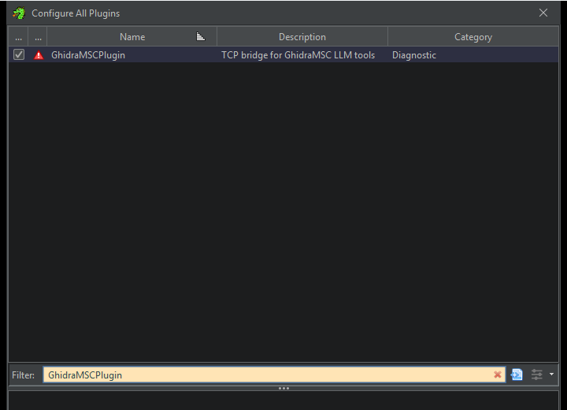
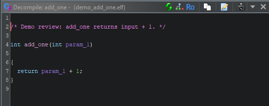

# GhidraMSC User Manual

Ghidra 12.1.4 | CLI, HTTP, headless MCP, and CodeBrowser plugin MCP | October 2026

This manual takes you from a new local project to a read-only inspection and a saved, reversible comment. The included `demo_add_one.elf` generator makes a small synthetic x86-64 program; it is analysis data, not a program to execute. All screenshots show that disposable project. The PDF contains the images and works on its own. The editable source, image assets, and offline builder are in `docs/user-manual/`.

[[TOC]]

## 1. Prepare Ghidra and Python

Use Ghidra 12.1.4, its supported 64-bit JDK, and Python 3.10 or newer. The Windows walkthrough was verified with Ghidra 12.1.4, JDK 25, and Python 3.12. Keep the GhidraMSC directory intact; run terminal commands from its root, where `ghidramsc/` and `ghidramsc.toml.example` live. Use a Python interpreter that imports both `ghidramsc` and `pyghidra` for CLI, HTTP, and headless MCP. GUI MCP needs `ghidramsc` but connects to the Java plugin in the running Ghidra GUI.

```powershell
python --version
python -c "import ghidramsc, pyghidra; print('imports OK')"
```

If `pyghidra` is missing, install the wheels bundled in your Ghidra installation into that same Python interpreter. This operation can be offline:

```powershell
$ghidraRoot = "C:\path\to\ghidra_12.1.4_PUBLIC"
$wheels = "$ghidraRoot\Ghidra\Features\PyGhidra\pypkg\dist"
python -m pip install --no-index --find-links $wheels pyghidra
```

GhidraMSC runs from the extracted repository with `python -m ghidramsc`; it has no separate package installation step. For exact release prerequisites and other platforms, see the [project README](../../README.md).

## 2. Create a disposable project

1. Choose a disposable directory outside a production Ghidra project. In this example it is `C:\GhidraDemo`. Run the generator from the GhidraMSC root, then import and analyze the output with Ghidra's headless analyzer. Replace the Ghidra installation path with yours.

```powershell
New-Item -ItemType Directory C:\GhidraDemo -Force | Out-Null
python docs/user-manual/make_demo_elf.py C:\GhidraDemo\demo_add_one.elf
$analyzer = "C:\path\to\ghidra_12.1.4_PUBLIC\support\analyzeHeadless.bat"
& $analyzer C:\GhidraDemo ManualDemo_1214 `
  -import C:\GhidraDemo\demo_add_one.elf -analysisTimeoutPerFile 180
```

2. Confirm that `C:\GhidraDemo\ManualDemo_1214.gpr` and the matching `.rep` directory exist. The imported program name is `demo_add_one.elf`. The project name is `ManualDemo_1214`; they are different identities. GhidraMSC does not import binaries for you.

3. For CodeBrowser inspection, start Ghidra and open that exact `.gpr` project, then double-click `demo_add_one.elf`. Keep the GUI closed while a headless GhidraMSC process owns the project. The project window should show one program as in Figure 1.



The imported program has `add_one` at `00401000` and `_start` at `00401010`. Figure 2 shows the analyzed listing; Figure 3 shows the decompiler's `return param_1 + 1` result. Addresses are for this generated demo only. Continue to [the saved comment exercise](#8-save-and-reverse-one-comment) after choosing an interface.





## 3. Point headless interfaces at the project

Close Ghidra on `ManualDemo_1214` before using CLI, HTTP, or headless MCP. Copy `ghidramsc.toml.example` to `ghidramsc.toml` in the GhidraMSC root and set the three paths below. `project_path` is the directory containing the `.gpr`; `project_name` omits its extension.

```toml
[ghidramsc]
ghidra_install_dir = "C:/path/to/ghidra_12.1.4_PUBLIC"
project_path = "C:/GhidraDemo"
project_name = "ManualDemo_1214"
```

You can instead set `GHIDRAMSC_GHIDRA_INSTALL_DIR`, `GHIDRAMSC_PROJECT_PATH`, and `GHIDRAMSC_PROJECT_NAME` in the process environment. Set `GHIDRAMSC_CONFIG` if your config file is elsewhere. GUI MCP uses the project currently open in CodeBrowser and does not read this config.

Always obtain the program's exact project-relative name from `list_programs`. A command's `-b` value or MCP `binary` argument is that name, not the original ELF filesystem path. Folder-qualified names use forward slashes, such as `firmware/arm/example.bin`.

## 4. Inspect with the CLI

Run these from the GhidraMSC root with the CodeBrowser project closed. `--no-server` forces a direct one-shot call; each call starts a JVM. The first command is project-scoped, while the next two select the exact returned program.

```powershell
python -m ghidramsc list_programs --no-server
python -m ghidramsc list_functions -b demo_add_one.elf --no-server
python -m ghidramsc decompile_function -b demo_add_one.elf `
  0x401000 --no-server
```

In the verified walkthrough, `list_programs` returned `{"programs":["demo_add_one.elf"]}`. `list_functions` returned two entries: `add_one` at `00401000` and `_start` at `00401010`. The decompiler returned an `add_one` body containing `return param_1 + 1;`. Use `python -m ghidramsc <tool> --help` for a tool's exact CLI arguments and the [tool catalog](../../TOOL_CATALOG.md) for response fields.

## 5. Use one local HTTP session

HTTP keeps the headless JVM warm for repeated calls. With Ghidra closed on this project, start the server in one terminal:

```powershell
python -m ghidramsc serve -b demo_add_one.elf
```

In another PowerShell terminal, send local requests. The default listener is `127.0.0.1:13100`. The verified demo returned HTTP 200 for all three reads; `/health` reported `status: ok`, `/programs` returned the one demo program, and `/query` reported `binary: demo_add_one.elf`, `language_id: x86:LE:64:default`, and two functions.

```powershell
Invoke-RestMethod http://127.0.0.1:13100/health
Invoke-RestMethod http://127.0.0.1:13100/programs
$body = @{ command = "get_program_info"; args = @{}; `
  binary = "demo_add_one.elf" } | ConvertTo-Json
Invoke-RestMethod -Uri http://127.0.0.1:13100/query `
  -Method Post -ContentType "application/json" -Body $body
python -m ghidramsc shutdown
```

Stop the server before opening this project in Ghidra or starting headless MCP. Inspect response bodies, not just HTTP status. The endpoint is local and has no authentication; only expose it to trusted local clients.

## 6. Connect a headless MCP host

Configure a trusted MCP host to launch one process from the GhidraMSC root. This command uses the five read-only `minimal` tools and selects the demo as its default program:

```text
python -m ghidramsc mcp --mode headless --toolset minimal -b demo_add_one.elf
```

For example, an MCP host with a JSON server configuration can use this entry, replacing the working directory and Python path as needed:

```json
{
  "ghidramsc": {
    "type": "stdio",
    "command": "python",
    "args": ["-m", "ghidramsc", "mcp", "--mode", "headless",
             "--toolset", "minimal", "-b", "demo_add_one.elf"],
    "cwd": "C:/path/to/GhidraMSC"
  }
}
```

The host owns this process; do not start an extra headless owner for the same project. In the verified stdio session, `tools/list` advertised `list_programs`, `get_program_info`, `list_strings`, `list_functions`, and `decompile_function`. `list_programs` returned the one demo program; `get_program_info` returned the x86-64 ELF identity. Start with those two read-only calls. See [host-specific examples](../../USAGE.md) for VS Code, Codex, and Claude configuration.

## 7. Enable CodeBrowser plugin MCP

1. Shut down HTTP or headless MCP and open the demo project in Ghidra. Install `plugin/dist/GhidraMSCPlugin.zip` through Ghidra's `File > Install Extensions`, then restart Ghidra. On a machine with the plugin already installed, this install step is unnecessary.

2. Open `demo_add_one.elf` in CodeBrowser. Use `File > Configure...`, then `Configure All Plugins`. Filter for `GhidraMSCPlugin` and check its box. Figure 4 captures the enabled entry in Ghidra 12.1.4. The plugin listens on `127.0.0.1:18100` while the GUI owns the project.



3. Give the MCP host this launch command from the GhidraMSC root. The Python bridge connects to the already running plugin; it does not open a second Ghidra project.

```text
python -m ghidramsc mcp --mode gui --toolset all
```

Ask the host for `list_programs`, then use the returned exact program name. GUI mode includes five extra CodeBrowser-context tools. In the verified walkthrough, GUI MCP read the saved comment, selected `00401000` in CodeBrowser, set a plate comment, and `save_program` reported dirty state moving from true to false. Figure 5 shows that saved plate comment in the decompiler.



## 8. Save and reverse one comment

Use a disposable project for this exercise. Close Ghidra and other persistent owners first. The following one-shot CLI command was verified on `00401000`; it created an end-of-line comment and saved the program. A successful response included `transaction.committed: true`, the stored comment, `persistence.status: success`, and `save.succeeded: true`.

```powershell
python -m ghidramsc get_comment_at_address -b demo_add_one.elf `
  0x401000 --type eol --no-server
python -m ghidramsc get_program_save_state -b demo_add_one.elf --no-server
$note = "Manual demo: this function returns input + 1."
python -m ghidramsc set_comment_at_address -b demo_add_one.elf `
  0x401000 $note --type eol --no-server --save
python -m ghidramsc get_comment_at_address -b demo_add_one.elf `
  0x401000 --type eol --no-server
```

To undo this specific exercise, set that comment to an empty string and save. The verified inverse returned `old` with the prior text, `stored: ""`, a committed transaction, and a successful save. A fresh process then read an empty comment and `dirty: false`.

```powershell
python -m ghidramsc set_comment_at_address -b demo_add_one.elf `
  0x401000 "" --type eol --no-server --save
python -m ghidramsc get_comment_at_address -b demo_add_one.elf `
  0x401000 --type eol --no-server
python -m ghidramsc get_program_save_state -b demo_add_one.elf --no-server
```

GUI MCP can also make a plate comment, as Figure 5 shows. Save through `save_program`, `Ctrl+S`, or `File > Save`. To discard an unsaved edit, close the program without saving, then reopen and verify the stored value. Do not rely on the absence of a prompt as proof of persistence. A committed mutation changes in-memory state; an explicit successful save and a cold readback establish the saved state. Check `status`, `error`, transaction, stored value, persistence, and dirty-state fields on every mutation result. A failed or partial one-shot mutation does not automatically save even with `--save`.

## 9. Choose a toolset and protect project state

`minimal` advertises five read-only orientation tools; `inspect` expands read-only inspection. `default` adds general reversing and annotation; `vuln-research` adds richer typing and export; `most` is broad; `all` advertises every tool available in the selected mode. The named profiles are plain text under `ghidramsc/toolsets/`. Restart MCP after changing a profile. Toolsets limit the advertised MCP surface; they do not restrict CLI or HTTP operations. For exact tool parameters and effects, use the [tool catalog](../../TOOL_CATALOG.md).

Only one local Ghidra owner can hold a project lock. Close CodeBrowser before CLI/HTTP/headless MCP; stop headless owners before opening the GUI. GUI MCP shares the GUI owner. Saving with a newer Ghidra version may upgrade program data so an older version cannot reopen it. Make a separate project copy before crossing versions. A headless open can mark a program dirty due to an in-memory upgrade; inspect `get_program_save_state` immediately and choose whether to save that conversion. Do not save a production project merely to clear a dirty flag.

Use GhidraMSC only with projects, binaries, comments, and LLM hosts you trust. An LLM host can request mutations if its exposed toolset contains them. The local HTTP and plugin TCP listeners have no general remote authorization layer; keep them on loopback and do not forward their ports to untrusted peers. Back up valuable projects before annotation or type changes.

## 10. Troubleshoot and finish

- `ModuleNotFoundError: pyghidra`: activate the intended Python environment and install Ghidra's bundled PyGhidra wheel into it; re-run the import check in Section 1.
- Project lock or open failure: find the GUI, HTTP server, or MCP process already using that exact `.gpr`; stop it normally. Do not delete a lock while an owner is running.
- Empty `list_programs` or wrong binary: confirm the import completed, the config points to the correct `.gpr`, and `-b` is the exact returned project-relative name.
- Plugin connection refused on port 18100: open the program in CodeBrowser, check `GhidraMSCPlugin` in `Configure All Plugins`, and verify the plugin's local listener before starting GUI MCP.
- Mutation appears to succeed but is absent after reopen: inspect its transaction and persistence fields; save explicitly, close normally, then cold-read the value.
- GUI prompts to upgrade program data: decide whether this disposable project may be upgraded. For a valuable project, use a copy before accepting and saving.

Close HTTP/MCP and Ghidra normally before deleting a demo project. Once no process owns it, remove `ManualDemo_1214.gpr`, `ManualDemo_1214.rep`, and the generated `demo_add_one.elf` only from your chosen disposable directory. The authoritative short setup is [USAGE](../../USAGE.md); the [README](../../README.md) and [tool catalog](../../TOOL_CATALOG.md) cover all interfaces and tools.
